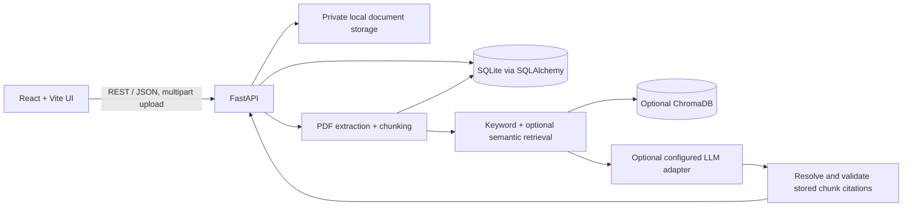

# CiteWise AI architecture

## 1. Proposed folder structure

```text
CiteWise/
|-- backend/
|   |-- app/
|   |   |-- api/                 # FastAPI routers and dependencies
|   |   |-- core/                # Settings and cross-cutting concerns
|   |   |-- db/                  # SQLAlchemy engine and session
|   |   |-- models/              # Relational persistence models
|   |   |-- schemas/             # API request and response models
|   |   |-- services/
|   |   |   |-- documents/       # Validation, extraction, chunking
|   |   |   |-- retrieval/       # BM25, optional embeddings, fusion
|   |   |   |-- llm/             # OpenAI-compatible provider adapter
|   |   |   |-- analysis/        # Analysis, comparison, gap exploration
|   |   |   `-- exports/         # PDF and DOCX exports
|   |   `-- main.py
|   `-- tests/
|-- frontend/
|   `-- src/{app,components,features,pages,services,types}/
|-- docs/                        # Architecture, API, setup, testing
|-- storage/                     # Private uploads, database, vector index
|-- .env.example
`-- README.md
```

## 2. System architecture



The API remains the authority for document identity, page numbers, chunks, and citations. Optional services are behind adapters so the application can run with SQLite, PDF text extraction, and keyword search without paid credentials.

## 3. Database design

- `documents`: stable ID, original filename, safe storage path, SHA-256, byte size, MIME/PDF validation, status, timestamps, extracted metadata JSON, and processing error.
- `pages`: document ID, 1-based PDF page number, text, extraction method, and warnings. A row exists for every page, including pages whose extraction failed.
- `chunks`: document and page foreign keys, stable chunk ID, ordinal, section label, text, token/character count, and optional vector ID.
- `conversations` and `messages`: user conversation history, selected document scope, answer mode, and timestamps.
- `citations`: message ID, chunk ID, excerpt, and validated page/document references.
- `analyses` and `comparisons`: structured output JSON, operation type, source document IDs, and timestamps. Individual claims should reference chunk IDs.

Use SQLAlchemy relationships and portable column types. SQLite is the local default; a PostgreSQL URL can be supplied later. Schema changes should use Alembic once migrations are introduced.

## 4. PDF processing workflow

1. Enforce upload size, extension, PDF MIME/content signature, and safe generated storage names.
2. Hash bytes with SHA-256; return the existing document for a duplicate rather than silently making a second record.
3. Create a `processing` document row and store the original bytes outside the web root.
4. Extract every page with pdfplumber, recording page-local errors and extraction method.
5. If OCR is enabled and a page has no meaningful text, render it and call pytesseract when both the Python binding and Tesseract executable are installed. Report missing OCR or unreadable pages in warnings.
6. Extract metadata and section headings conservatively; label unavailable fields as not found.
7. Chunk within pages (unless a later explicitly configured cross-page strategy retains all page references), store text with document/page/section metadata, and create optional embeddings.
8. Persist counts and warnings; use `processed`, `processed_with_warnings`, or `failed` states.

## 5. RAG architecture

Normalize the query, retrieve candidates using BM25 and (when configured) semantic vectors, apply document filters, then merge and rank results. Construct prompts only from retrieved chunks and ask the model to identify supporting chunk IDs for factual claims. The API resolves IDs against stored chunks and returns only real document names, original pages, and excerpts. Retrieval alone is not treated as proof of answer correctness.

Without an LLM, keyword search is available. There are no canned answers presented as AI output. Retrieval evaluation should include Precision@K, Recall@K, and MRR on a small, reproducible query set. Answer evaluation should include evidence sufficiency and citation correctness, including questions whose answer is absent.

## 6. Citation validation strategy

- The model may propose chunk IDs but never controls source filename, page number, or excerpt.
- The server accepts only IDs present in the current retrieval result and database.
- Each response citation is generated from its stored chunk and parent page/document records.
- UI links use document ID + original page number; source excerpts remain visible.
- Unsupported claims are omitted or marked insufficient. Distinguish verbatim source facts from interpretations.
- Compare numeric outcomes only alongside dataset, conditions, and metric evidence. Do not infer novelty from a small uploaded corpus.

## 7. LLM integration strategy

The initial adapter supports `none` or an OpenAI-compatible chat completion endpoint. Provider, model, endpoint, and secret come from validated environment settings. The default provider is `none`. Requests use bounded context, JSON response mode when supported, timeouts, and error handling. Secrets never appear in responses or logs. The prompt requires abstention when retrieved evidence is insufficient, but server-side citation validation remains mandatory.

## 8. API endpoint design

Base path: `/api`. Initial endpoints:

- `GET /api/health`: process and database readiness.
- `POST /documents`: upload a PDF and return processing state.
- `GET /documents`: paginated library and status filters.
- `GET /documents/{id}`: metadata and processing warnings.
- `DELETE /documents/{id}`: remove the selected document and its stored derivatives.
- `GET /documents/{id}/pages/{page}`: inspect extracted source text.
- `POST /api/search`: keyword/hybrid retrieval with document filters and source references.
- `POST /api/chat`: grounded answer where configured, or explicit retrieval-only/insufficient response.
- `POST /api/analysis`, `/api/comparisons`, `/api/gaps`, `/api/summaries`: evidence-linked operations.
- `POST /api/exports`: generate a PDF/DOCX report from a stored result.
- `GET /api/dashboard`, `/api/settings`, `/api/conversations`: dashboard, public capability state, and chat history.

Use Pydantic request/response schemas, consistent error envelopes, pagination, and explicit status values. Long-running processing should move to a task queue when deployment needs justify it.

## 9. Frontend page structure

- Landing / product status
- Dashboard and recent processing activity
- Document library with upload and deletion confirmation
- Paper analysis with claim-level citations
- Research chat with document filters, citations, excerpts, and insufficient-evidence states
- Comparison with caveats around cross-dataset metrics
- Gap explorer separating explicit limitations, inferred opportunities, and hypotheses
- Summary generator with export actions
- Settings for provider status and local configuration guidance

Shared layout, navigation, accessible controls, loading/error/empty states, notifications, and responsive behavior belong in reusable components. A control is rendered only when its action is connected or it is clearly marked unavailable.

## 10. Development milestones

1. Architecture and folder structure — implemented.
2. Backend foundation, settings, database, and health endpoint — implemented.
3. Secure PDF upload, page extraction, metadata, chunking, and status — implemented.
4. BM25 retrieval and optional embeddings/vector store — implemented; optional real model packages remain an opt-in install.
5. Grounded chat, citation validation, and abstention behavior — implemented for an OpenAI-compatible provider; provider behavior is tested with mocks.
6. Structured paper analysis — implemented and provider-gated.
7. Multi-paper comparison — implemented with a numeric comparability gate.
8. Evidence-backed research gap explorer — implemented with explicit/inferred/hypothesis labels.
9. Frontend integration and dashboard — implemented.
10. PDF/DOCX export — implemented from stored analysis runs.
11. Test suite, security review, optimization, and final documentation — baseline suite and docs implemented; production authentication, migrations, background processing, and a representative retrieval benchmark remain future work.
